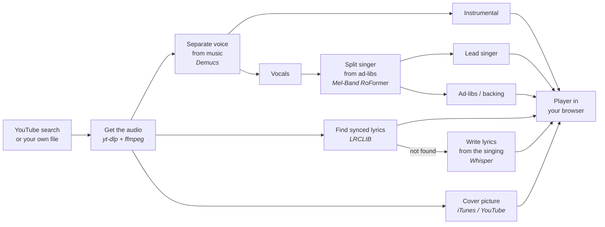

# Kairokee

**Karaoke from any song, on your own computer.** Search a song (or pick an audio file), and Kairokee
removes the singer, keeps the music, and shows the lyrics in time with the music, lighting up each word
as it is sung. You can bring the singer and the ad-libs back in, change the key, slow the song down,
and put the lyrics full screen on a TV.

Works on **Windows 10/11** and on **Macs with Apple Silicon** (M1 or newer). Everything runs on your
computer: nothing you make is uploaded or shared.

> For personal use only, with music you are allowed to use.

---

## Contents

- [What you can do](#what-you-can-do)
- [Which computers](#which-computers)
- [Install on Windows](#install-on-windows)
- [Install on a Mac](#install-on-a-mac)
- [Using Kairokee](#using-kairokee)
- [How it works](#how-it-works)
- [How fast is it](#how-fast-is-it)
- [Where things are stored](#where-things-are-stored)
- [Updates](#updates)
- [If something goes wrong](#if-something-goes-wrong)
- [What Kairokee downloads](#what-kairokee-downloads)
- [For developers](#for-developers)

---

## What you can do

| | |
|---|---|
| **Search any song** | Type a song and artist; pick one of the YouTube results. |
| **Use your own file** | Or pick an audio or video file from your computer (mp3, m4a, wav, flac, mp4...). |
| **Music without the singer** | The instrumental is played on its own. |
| **Singer and ad-libs on or off** | Turn the main singer and the backing vocals / ad-libs up, down or off, separately. |
| **Lyrics in sync** | Synced lyrics are found online, or written by the app from the singing. |
| **Word by word** | The words light up as they are sung (exactly, when the app wrote the lyrics). |
| **Key** | Sing it lower or higher, up to 6 steps either way. |
| **Speed** | 70% to 120% for practice, without changing the key. |
| **Full screen** | Big lyrics for a TV or a party, with dots counting down before the singing starts again. |
| **Fix the lyrics** | Choose other lyrics found online, edit them, shift their timing, or restore the previous ones. |
| **From your phone** | Open Kairokee on a phone on the same Wi-Fi. |
| **Delete with undo** | Deleted songs can be brought back right away, and are kept for 30 days. |

---

## Which computers

| | Windows | Mac |
|---|---|---|
| **System** | Windows 10 (1809 or newer) or 11, 64-bit | macOS 14 Sonoma or newer |
| **Processor** | Any 64-bit PC. Windows on ARM (Snapdragon) needs Windows 11 and is slow (experimental) | Apple Silicon: M1, M2, M3, M4 or newer. **Intel Macs are not supported** |
| **Memory** | 6 GB minimum, 8 GB or more recommended | 6 GB minimum, 8 GB or more recommended |
| **Disk** | About 12 GB free | About 12 GB free |
| **Fast mode** | NVIDIA graphics card, GTX 900 series up to RTX 50 series. AMD / Intel graphics: experimental, see [How fast is it](#how-fast-is-it) | Always: uses the Mac's graphics (Metal) |
| **Internet** | Needed for the first setup (about 3 GB), searching, downloading songs and lyrics | Same |

---

## Install on Windows

1. Download **`Kairokee-Windows.zip`** (from the [latest release](../../releases/latest), or ask Mido).
2. Right-click the zip, choose **Extract All**, and extract it to a simple place such as your
   **Documents** folder. Do not run it from inside the zip.
3. Open the new **Kairokee** folder and double-click **`Kairokee.bat`**.
4. If Windows says *"Windows protected your PC"*, click **More info**, then **Run anyway**
   (Kairokee is not signed with a paid certificate).
5. **The first time**, a black window sets everything up: it downloads about 3 GB and takes
   10 to 60 minutes. Keep the window open. If the internet drops, open `Kairokee.bat` again: it continues.
6. Your browser opens Kairokee, and a **Kairokee icon** is added to your desktop. Next time, start it from
   that icon: it opens in a few seconds.

**To stop Kairokee**, close the black window.

| File in the folder | What it does |
|---|---|
| `Kairokee.bat` | Starts Kairokee (only this computer can open it) |
| `Kairokee-Phone.bat` | Starts Kairokee so phones on the same Wi-Fi can open it too |
| `Kairokee-Repair.bat` | Installs the program parts again (keeps your songs) |

---

## Install on a Mac

1. Download **`Kairokee-Mac.zip`** (from the [latest release](../../releases/latest), or ask Mido).
2. Double-click the zip. A **Kairokee** folder appears; you can move it anywhere (for example Documents).
3. Open the folder and double-click **`Kairokee.command`**.
4. The first time, macOS blocks it (Kairokee is not signed with a paid Apple certificate). To allow it:
   - click **Done**, then open **System Settings > Privacy & Security**, scroll down and click
     **Open Anyway** next to *"Kairokee.command was blocked"*, and confirm.
   - (On macOS 14 you can also right-click `Kairokee.command`, choose **Open**, then **Open**.)
   You only do this once.
5. **The first time**, a Terminal window sets everything up: about 3 GB, 10 to 60 minutes.
   Keep it open (the Mac is kept awake meanwhile).
6. Your browser opens Kairokee.

**To stop Kairokee**, close the Terminal window (or press Ctrl+C in it).

| File in the folder | What it does |
|---|---|
| `Kairokee.command` | Starts Kairokee (only this Mac can open it) |
| `Kairokee-Phone.command` | Starts Kairokee so phones on the same Wi-Fi can open it too |
| `Kairokee-Repair.command` | Installs the program parts again (keeps your songs) |

If double-clicking does nothing or says *permission denied*, open Terminal, type `chmod +x ` (with a
space), drag the three `.command` files into the window, and press Return.

---

## Using Kairokee

### Make a karaoke song

1. On the home page, type the song and artist and press **Search**, or press
   **Use a song file from this device** to use your own file.
2. Press **Make karaoke** next to the right result, and choose:
   - **Singer and ad-libs separately**: you can switch the ad-libs on or off on their own (takes longer), or
   - **Whole vocals**: one vocals track, faster.
   Kairokee shows how long it should take on your computer.
3. Follow the steps on the page. You can press **Stop** at any time (nothing is saved then).
4. The song opens in the player and is added to **Your songs**.

### The player

| Control | What it does |
|---|---|
| **Play / position bar** | Play, pause, jump anywhere. Click a lyric line to jump to it. |
| **Music** | Volume of the instrumental. |
| **Singer's voice** | Bring the main singer back, at any volume (to learn a song, or sing along). |
| **Ad-libs and backing** | The backing vocals / ad-libs on their own (when the song was split). |
| **Key** | **−** / **+**: lower or higher, up to 6 steps. Takes a few seconds the first time; remembered per song. |
| **Speed** | 70% to 120%, the key stays the same. |
| **Separate ad-libs from the singer** | For songs made with "Whole vocals": split them later. |
| **Write lyrics** | Lets the app write the lyrics from the singing (choose Arabic, English, French, or auto). |
| **Find online lyrics** | Shows other synced lyrics found online, best match first, so you can pick. |
| **Restore previous lyrics** | Switch back to the lyrics you had before (press again to switch back). |
| **Lyrics timing** | Lyrics too early or too late? Move them by tenths of a second. Remembered per song. |
| **Edit lyrics** | Change the text and times by hand (`[01:23.45] text` per line). |
| **Full screen** | Big lyrics only, for a TV or a party. |
| **Delete this song** | Removes it from your songs (press **Undo** to bring it back). |

**Keyboard:** Space = play / pause, ← / → = 5 seconds back / forward, F = full screen.

### From your phone

Start Kairokee with **`Kairokee-Phone`** (`.bat` on Windows, `.command` on Mac). The window shows an
address like `http://192.168.1.19:8000`: type it in the phone's browser (same Wi-Fi).
- Windows: if the phone cannot open it, set your Wi-Fi to **Private** (Settings > Network & Internet >
  Wi-Fi > your network) and click **Allow** if Windows asks.
- Mac: if it asks whether Python may accept incoming connections, click **Allow**.

Only use phone mode on a Wi-Fi you trust: anyone on it can open the app.

---

## How it works

When you press **Make karaoke**, Kairokee runs these steps on your computer:

1. **Get the audio.** For a YouTube result, [yt-dlp](https://github.com/yt-dlp/yt-dlp) downloads the
   audio (with a small helper, Deno, that YouTube now requires). Your own files are converted with ffmpeg.
2. **Separate the voice from the music.** An AI model, [Demucs](https://github.com/facebookresearch/demucs)
   (htdemucs), splits the song into *vocals* and *everything else*. Everything else is your instrumental.
3. **Split the singer from the ad-libs** (optional). A second model (Mel-Band RoFormer, "karaoke
   gabox v2", run by [audio-separator](https://github.com/nomadkaraoke/python-audio-separator)) splits the
   vocals into the main singer and the backing vocals / ad-libs.
4. **Find the lyrics.** Kairokee searches [LRCLIB](https://lrclib.net), a free database of time-synced
   lyrics, and only accepts lyrics whose title really matches the song (Arabic spelling variants
   included). It prefers Arabic script for Arabic songs and the closest length.
5. **Or write them.** If no synced lyrics are found, [Whisper](https://github.com/openai/whisper) (speech
   recognition) listens to the singer and writes the lyrics, with the time of every word.
6. **Cover picture** from Apple's iTunes search (only if the artist matches), or the YouTube picture.
7. **Play.** The tracks are saved as MP3s. The web page plays them together in perfect sync, with a
   separate volume for each, and shows the lyrics in time.

Behind the scenes, Kairokee is a small local web server (Python, FastAPI) that your browser talks to.
The heavy AI steps each run in their own helper program, so a problem in one can never take the app down,
and if the graphics chip fails, the step is retried automatically on the processor.

### Which chip does the work

| Step | Windows + NVIDIA | Windows + AMD / Intel (experimental) | Windows, processor only | Mac (Apple Silicon) |
|---|---|---|---|---|
| Voice / music | Graphics card (Demucs) | Graphics chip (ONNX voice model via DirectML) | Processor (Demucs) | Apple graphics (Demucs) |
| Singer / ad-libs | Graphics card | Processor | Processor | Apple graphics |
| Writing lyrics | Graphics card (faster-whisper) | Processor | Processor | Apple graphics (mlx-whisper) |
| Key change | Processor (ffmpeg, a few seconds) | Processor | Processor | Processor |

---

## How fast is it

Times for a 3 to 4 minute song, after the first use (the first use of each feature downloads its model):

| Computer | Make karaoke (whole vocals) | + split the ad-libs | Write lyrics |
|---|---|---|---|
| Windows + NVIDIA card (e.g. RTX 3050 Ti) | under a minute | + 3 minutes | about 20 seconds |
| Mac with Apple Silicon | 1 to 2 minutes | + a few minutes | under a minute |
| Windows + AMD / Intel graphics | a few minutes | + 30 minutes or more | a few minutes |
| Windows, processor only | several minutes | + 30 minutes or more | a few minutes |

Kairokee measures your computer as you use it, and shows the expected time before you start.
On slow computers it suggests **Whole vocals**: you can split the ad-libs later, only for the songs you
really want.

**AMD / Intel graphics (Windows, experimental):** during the first setup Kairokee measures whether the
graphics chip separates the voice faster than the processor, and only uses it if it clearly does. It
uses a different voice model there (UVR-MDX-NET Voc_FT), because Demucs cannot run on these chips.
The ad-lib split and lyrics stay on the processor (no speed gain on these chips, measured).

---

## Where things are stored

| | Windows | Mac |
|---|---|---|
| **The program** (small; can be moved or replaced) | the Kairokee folder you extracted | the Kairokee folder you unzipped |
| **Installed parts, AI models and your songs** | `%LOCALAPPDATA%\Kairokee` | `~/Library/Application Support/Kairokee` |
| **Your songs** | `...\Kairokee\data\output` | `.../Kairokee/data/output` |
| **Deleted songs** (kept 30 days) | `...\Kairokee\data\deleted` | `.../Kairokee/data/deleted` |
| **Logs** | `...\Kairokee\logs` | `.../Kairokee/logs` |

Each song is a folder with `instrumental.mp3`, `vocals.mp3` (and `lead.mp3` + `backing.mp3` when split),
`lyrics.lrc`, `cover.jpg` and `meta.json`.

Replacing the program with a newer version keeps all your songs and models.
**To remove Kairokee completely**, delete the program folder **and** the folder above.

---

## Updates

When a newer Kairokee is available, the home page says so and lists what changed. Ask Mido for the new zip,
extract it, and start it: it keeps your songs (the first start may set itself up again).
The version you have is shown at the bottom of the home page.

YouTube changes often, so Kairokee updates its YouTube downloader (yt-dlp) by itself, at most once a day.

---

## If something goes wrong

| Problem | What to do |
|---|---|
| Kairokee stopped working, or the graphics card / driver changed | Open **Kairokee-Repair** (keeps your songs and models). |
| YouTube search or download fails | Just open Kairokee again (it updates the downloader), with the internet on. |
| Windows says a "Visual C++" component is missing | Install it from the link shown, then open Kairokee-Repair. |
| NVIDIA card but Kairokee uses the processor | Update the driver from nvidia.com/drivers (RTX 50 cards need version 580 or newer), then open Kairokee-Repair. |
| Wrong lyrics | **Find online lyrics** and pick another, or **Write lyrics**, or **Edit lyrics**. |
| Lyrics early or late | Use **Lyrics timing**. |
| Another program uses port 8000 | Nothing to do: Kairokee picks the next free port and tells you. |
| Anything else | Send Mido the newest file from the **logs** folder (see [Where things are stored](#where-things-are-stored)). |

---

## What Kairokee downloads

Only from well-known official sources:

| What | From |
|---|---|
| The installer tool (uv), a private copy of Python, Deno | GitHub (fixed versions, checksums verified) |
| The programs (PyTorch and others) | pytorch.org and pypi.org |
| ffmpeg (audio tool) | GitHub / gyan.dev (Windows), ffmpeg.martin-riedl.de (Mac), checksums verified |
| The AI models | Hugging Face and GitHub (only when a feature is first used) |
| Songs you pick | YouTube, through yt-dlp |
| Lyrics / cover pictures | LRCLIB / Apple iTunes search |
| Update notice | a small file on GitHub saying the newest version |

Nothing is installed outside the Kairokee folders, and no administrator password is needed.

---

## For developers

### Layout

| Path | What |
|---|---|
| `app/kairokee.py` | The pipeline: download, separation (Demucs / ONNX), ad-lib split, lyrics (LRCLIB / Whisper), covers, key change. Also usable from the command line: `python kairokee.py "song name"` |
| `app/server.py` | Local web server (FastAPI): jobs, library, lyrics tools, key, delete, uploads, update check |
| `app/static/index.html` | The whole web page and player (no build step) |
| `setup/launch.ps1`, `Kairokee*.bat` | Windows launcher and first-run setup |
| `setup/launch.sh`, `Kairokee*.command` | Mac launcher and first-run setup |
| `setup/requirements.txt`, `setup/constraints.txt` | Python packages and their exact versions (shared by both systems) |
| `setup/selftest.py` | Checks PyTorch and the graphics chip after setup |
| `setup/dml_bench.py` | Measures AMD / Intel graphics against the processor (Windows setup) |
| `tools/build_release.py` | Builds both zips |
| `tools/publish_update.py` | Publishes the "new version" notice |
| `tools/smoke_test.py` | Uses every main feature once against an installed Kairokee |
| `tools/bench_split.py` | Speed / quality benchmark for the ad-lib splitter |
| `tools/make_icon.py` | Draws the app icon |
| `.github/workflows/test.yml` | Installs from scratch on a clean Mac and Windows PC and runs the smoke test |

### Making a new version

1. Raise `APP_VERSION` in `app/kairokee.py`.
2. Run the automatic install test: Actions tab > **Install and test** > Run workflow (started by hand only,
   because Mac minutes are expensive on private repos).
3. `python tools/build_release.py`: writes `Kairokee-Windows.zip` and `Kairokee-Mac.zip` next to this
   folder, with the right line endings and the executable permission the Mac `.command` files need.
   Don't zip by hand on Windows.
4. Publish a GitHub release with the two zips.
5. `python tools/publish_update.py "What changed" "..."`: everyone's Kairokee then shows the notice
   (it reads a secret gist; the code stays private).

### Launcher options

| Windows (`setup\launch.ps1`) | Mac (`setup/launch.sh`) | |
|---|---|---|
| `-Phone` | `--phone` | Phones on the same Wi-Fi can open the app |
| `-Repair` | `--repair` | Reinstall the program parts |
| `-SetupOnly` | `--setup-only` | Install everything but do not start (used by the tests) |

Environment variables: `KAIROKEE_HOME` (install folder), `KAIROKEE_IGNORE_NVIDIA=1` (Windows, test the
AMD / Intel path on a PC that also has an NVIDIA card).
